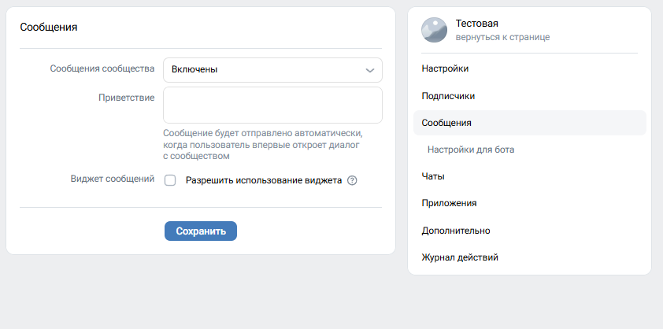
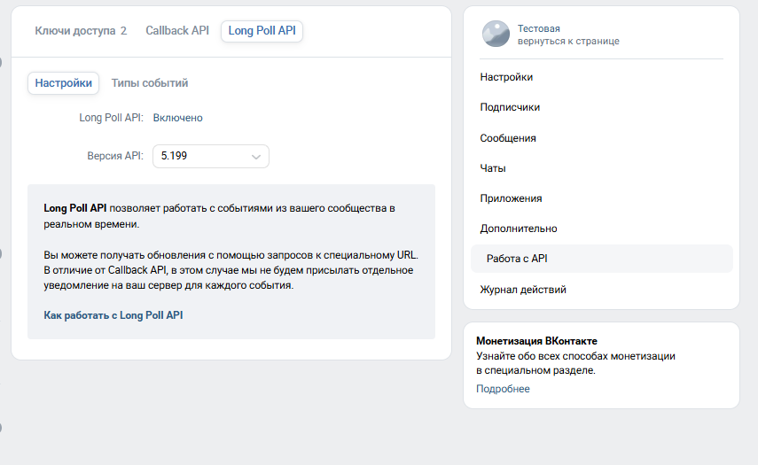
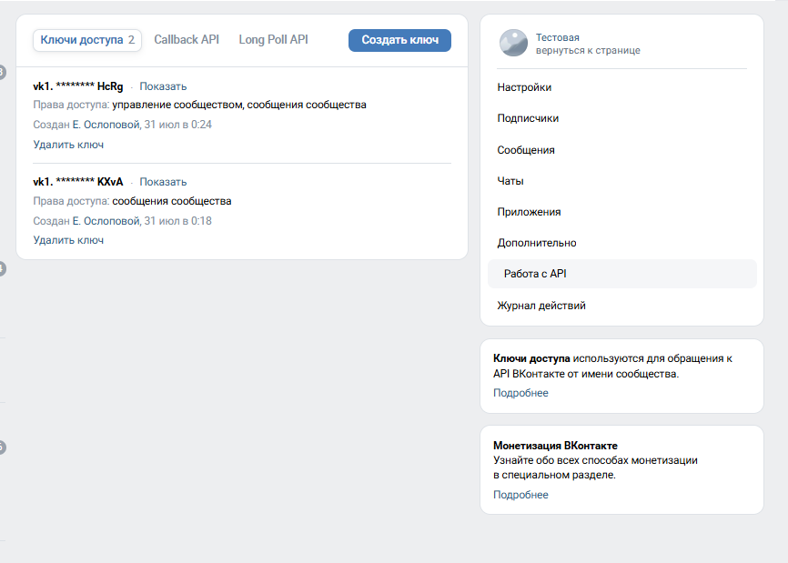
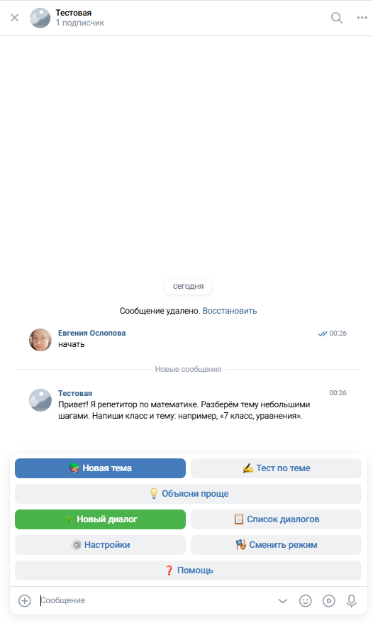
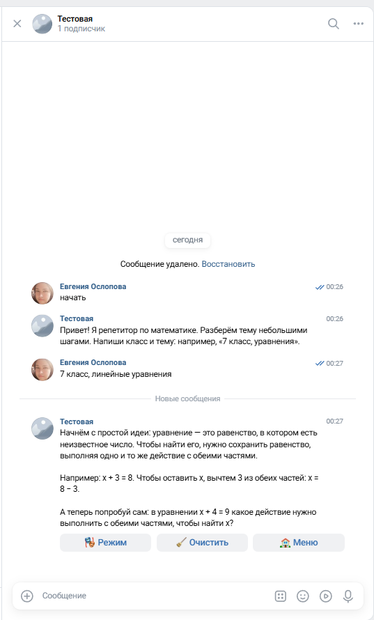
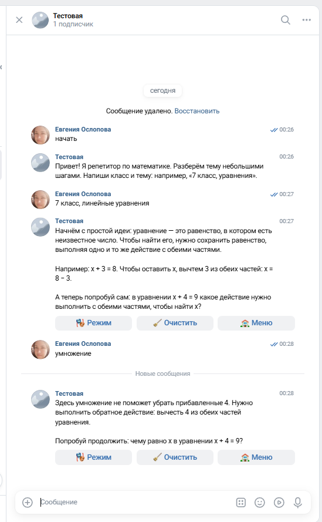
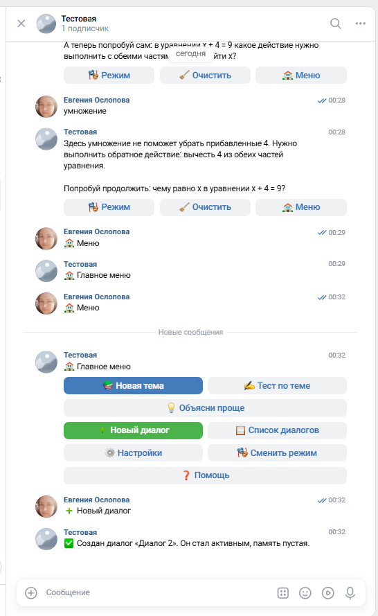
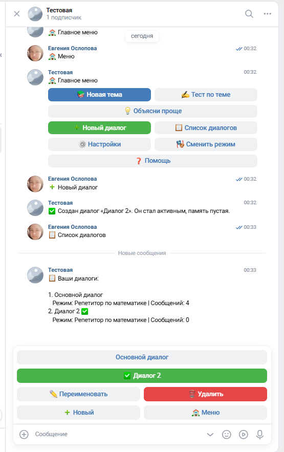

# Отчёт по ДЗ VPf09: репетитор по математике в VK

**Вариант:** продвинутый — собственный режим и сохранение долгосрочных фактов.

**Дата проверки:** 3 ноября 2026 года. **Разработка:** Claude Code (исходный бот) и Codex (адаптация и репетитор).

## Задача и результат

Создан бот, который помогает школьнику понять конкретную тему математики. Ученик указывает класс и тему. Бот объясняет материал небольшими частями, задаёт вопрос, ждёт ответа, при ошибке даёт подсказку и предлагает новую попытку. По запросу доступны другое объяснение и короткий тест по одному вопросу.

В основе — проект из урока: Python, VKBottle, независимые диалоги, переключение ролей и история последних 100 сообщений в JSON. Новый режим «Репетитор по математике» включён по умолчанию; пять исходных режимов сохранены.

## Дополнительная функция

Учебные факты сохраняются отдельно от короткой истории:

- `settings.grade` — класс ученика;
- `dialogs[].study.topic` — тема конкретного диалога;
- `exchanges` и `last_activity` — число успешных обменов и время последнего занятия.

Эти сведения переживают перезапуск и обрезку истории. «Новая тема» очищает текущую историю и тему, сохраняя класс. Класс можно изменить в настройках. Другой диалог имеет отдельную тему и контекст. Автоматическая оценка освоения темы не реализована.

## Модель и отличие от примера урока

Используется `gpt-6-luna` через OpenAI-совместимый сервис **aiprimetech.io**, а не Gemini через ProxyAPI. Выбор сделан потому, что это уже использовавшееся и проверенное подключение из предыдущих заданий. Модель показала подходящее поведение на коротком учебном диалоге; сравнение стоимости и качества моделей не проводилось.

Один отдельный проверочный запрос израсходовал **534 токена**: 340 входных и 194 выходных. Это расход данного запроса, а не всего проекта. Демонстрационный режим — «Репетитор по математике», тема — линейные уравнения, 7 класс.

## Что изменено в коде

| Изменение | Файлы |
|---|---|
| Подключение GPT, обработка ошибок и учёт токенов проверки | `services/openai_provider.py`, `services/ai_service.py`, `config/settings.py`, `probe.py` |
| Правила пошагового объяснения, подсказок и проверки понимания | `config/prompts.py` |
| Сбор и сохранение класса и темы | `services/tutor_service.py`, `models/user_data.py`, `bot/handlers.py` |
| Кнопки новой темы, другого объяснения, теста и видимого меню | `keyboards/menus.py`, `bot/messages.py` |
| Защита от второго экземпляра в одной папке | `utils/instance_lock.py`, `main.py` |
| Проверки памяти, диалогов, провайдера и репетитора | `tests/` |

## Проверки

**Автоматически:** 16 тестов пройдены. Проверены обрезка памяти, изоляция диалогов, переименование и ограничения удаления, ошибки API без порчи истории, сохранение учебных фактов, смена темы и отображение кнопок меню.

**С настоящими сервисами:** GPT вернул короткое объяснение уравнения и один вопрос; VK подтвердил права на сообщения и управление, включённые Long Poll и входящие сообщения.

**Вручную в VK:** получено приветствие, выполнен разбор темы «7 класс, линейные уравнения». На неверный ответ «умножение» бот объяснил необходимость вычесть 4 из обеих частей и предложил продолжить. Создан второй диалог; список показал 4 сообщения в первом и 0 во втором.

Найдена проблема интерфейса: после возврата в меню VK скрывал обычную клавиатуру. Меню изменено на inline-кнопки под сообщением; исправление подтверждено повторной ручной проверкой.

### Настройки сообщений

### Long Poll

### Права ключа

Полные значения ключей скрыты интерфейсом VK.

### Главное меню

### Объяснение темы

### Разбор ошибки

### Исправленное меню и создание диалога

### Список диалогов

## Запуск

Инструкция — в [README.md](README.md). Ключи задаются локально по `.env.example`. В репозитории нет реальных ключей, истории учеников, логов, кеша VKBottle и учебников из раздатки вебинара.

## Ограничения и вывод

Реализован текстовый репетитор; фотографии и учебники бот не читает. Педагогическое поведение задаётся инструкцией модели и требует проверки взрослым. Один успешный пример не доказывает корректность всех математических ответов. Сервер и автозапуск не настраивались: бот отвечает, пока программа запущена на компьютере.

Получен проверенный учебный прототип: объяснение темы, диалог с подсказками, отдельные беседы и сохранение учебных фактов. Отправка задания и решение куратора этим отчётом не подтверждаются.
